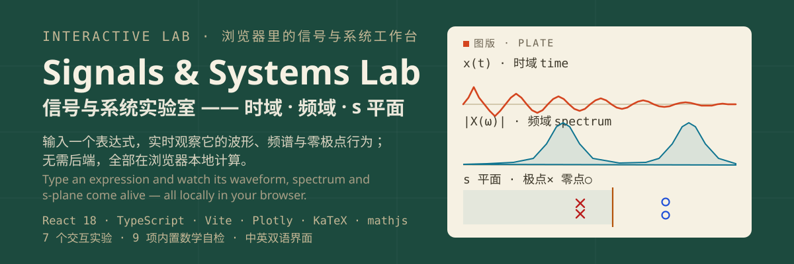
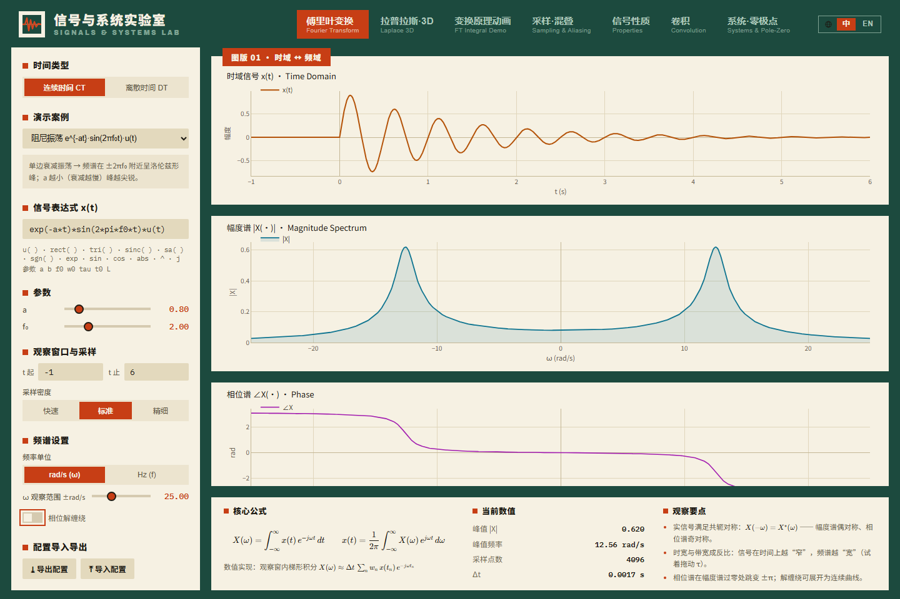
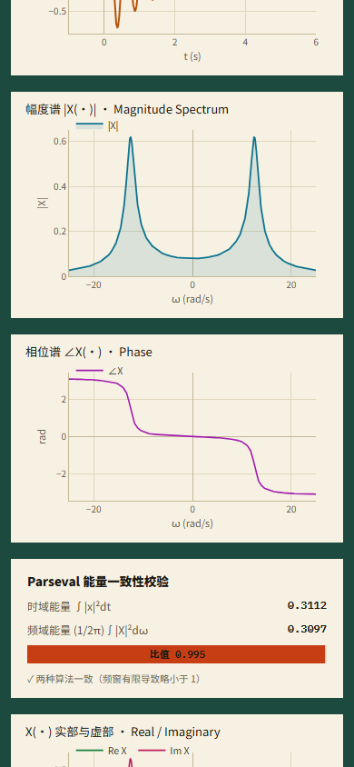

[简体中文](README.md) · **English**

# Signals & Systems Lab

Turn expressions into interactive time-domain, frequency-domain and s/z-plane experiments. Change a parameter, inspect the result, then export a chart or share a configuration.



[](https://github.com/LINYEANSHU/signals-lab/actions/workflows/ci.yml)
[](LICENSE)

## In the app



<details>
<summary>Show the mobile layout</summary>



</details>

## Start

Use Node.js 18+; CI runs on Node 22.

```sh
npm ci
npm run dev
```

Open the terminal URL, normally `http://localhost:5173`. After dependencies are installed, the app runs locally in your browser without a backend or account.

Start in Fourier with a preset or `exp(-t*t)`, adjust the observation window, and compare waveform and spectrum. Switch Chinese/English in the header; keys `1`–`7` select modules.

## Seven ways to inspect a signal

| Module | What to explore |
|---|---|
| Fourier | CTFT/DTFT, magnitude/phase, energy checks and truncation |
| Laplace 3D | Complex-frequency surfaces, movable slices, ROC and the imaginary axis |
| Transform mechanism | Signal products, complex-plane accumulation and spectral values |
| Sampling and aliasing | Sampling rate, repeated spectra and sinc reconstruction |
| Signal properties | Shifts, scaling, differentiation and the convolution theorem |
| Convolution | Flip, slide, multiply and accumulate in CT/DT |
| Systems and poles/zeros | Transfer functions, pole placement, frequency and time response |

Modules include presets and JSON configuration snapshots; charts export to PNG. Expressions use a restricted mathjs language with `u`, `rect`, `tri`, `sinc`, complex values and adjustable parameters.

## Interaction

- Charts fit narrow screens; module navigation scrolls horizontally.
- Toggles support keyboard focus and Space; sliders and number fields have accessible names.
- PNG export shows pending and recoverable error states. Its action is visible without hover.
- Plotly draws the charts, KaTeX sets formulas, and calculations/configurations remain local.

## Build and verify

```sh
npm run build
npm run preview
```

Build runs TypeScript checks first. Development mode runs nine math self-checks, available in the console and `window.__devtestResults`. Recent checks cover all seven modules at desktop/phone widths, keyboard toggles, invalid-expression recovery and PNG download.

3D surfaces need WebGL. Recent browser verification used CPU SwiftShader without hardware GPU acceleration; this does not mean every browser defaults to a CPU backend.

## Numerical limits

CTFT uses a finite observation window and numerical approximation; signals that do not decay can produce truncation leakage. Continuous-time simulation supports first- and second-order models with a direct term. Discrete responses have an amplitude cap; continuous responses only have a bounded time window, so extreme unstable parameters can still overflow numerically. Visualizations support teaching and exploration, not a proof for every possible system.

Plotly and numerical dependencies make the production bundle substantial; first-load cost depends on deployment and device.

## Technology and license

React, TypeScript and Vite with Plotly.js, mathjs and KaTeX. Dependencies retain their licenses. The module sequence draws on the time-, frequency- and complex-frequency connections in Oppenheim and Willsky's *Signals and Systems*.

Project code: [MIT](LICENSE).

## Contributors

- [LINYEANSHU](https://github.com/LINYEANSHU)
