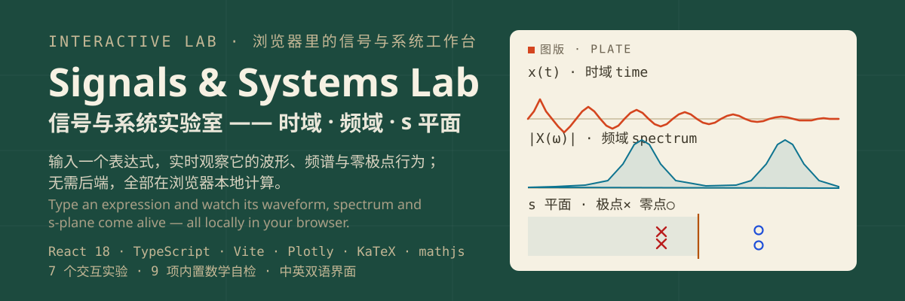
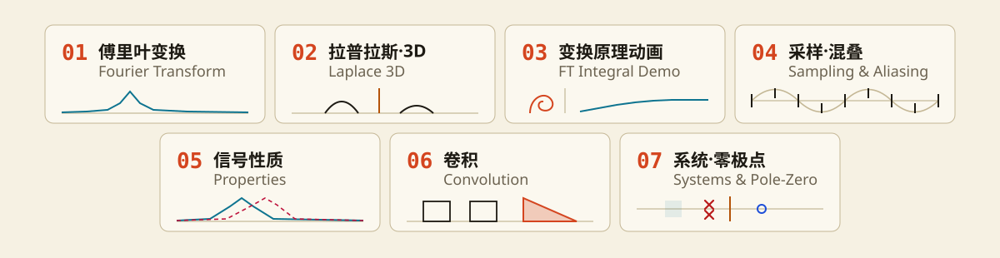

<div align="center">

**简体中文** | [English](README.en.md)

[](https://github.com/LINYEANSHU/signals-lab/actions/workflows/ci.yml)
[](LICENSE)



</div>

# 信号与系统交互实验室

一个帮助理解大学课程 **连续与离散时间信号与系统** 的交互式可视化工作台。输入任意受支持的数学表达式，实时观察信号与系统在时域、频域、复频域中的行为——卷积怎么"翻转滑动"、频谱为什么有泄漏、极点如何变成拉普拉斯曲面上的"山峰"。

纯浏览器本地运行，无需后端、无需注册。**所有用户表达式经 mathjs 受限表达式语言解析，绝不执行任意 JavaScript。**

<div align="center">

</div>

## 七个实验

| # | 实验 | 能做什么 |
|---|------|---------|
| 01 | **傅里叶变换** | CTFT / DTFT 切换；幅度谱、相位谱（解缠绕）、实部、虚部；rad/s ↔ Hz 单位切换；**Parseval 能量一致性实时校验**；截断泄漏主动提示 |
| 02 | **拉普拉斯·3D** | \|X(s)\| 三维曲面：极点=山峰、零点=谷底（解析 X(s) 或逐 σ 行数值扫描）；**琥珀色 jω 切面 = 傅里叶变换**；σ₀ 可移动切面演示"切面离开虚轴会怎样"；ROC 与虚轴关系自动判定 |
| 03 | **变换原理动画** | X(ω₀)=∫x(t)e^{-jω₀t}dt 逐点演示：信号×反向旋转复指数 → 乘积实/虚部 → **复平面累积积分螺线** → 频谱取值联动；支持对比频率 ω₁、跳到谱峰、进度拖动 |
| 04 | **采样·混叠** | 连续信号以 fs 采样，频谱周期重复；B₉₉ 能量带宽与 fs/2 自动对比判定欠采样；理想 sinc 插值重建与误差读数；**混叠折叠频率实时读出** |
| 05 | **信号性质** | 时移（幅度不变/相位加斜率）、频移（调幅搬移频谱）、尺度（**时宽×带宽不变量数值验证**）、卷积定理（\|Y\|=\|X·H\| 逐点重合）、微分（jωX）；理论预测曲线与数值结果直接对比 |
| 06 | **卷积** | CT/DT 卷积"翻转-滑动-相乘-求和"动画，**粉色重叠面积 = 当前的 y(t)**；频域 \|X\|·\|H\|=\|Y\| 校验；经典卷积对预设 |
| 07 | **系统·零极点** | H(s)/H(z) 双二阶系数编辑 + 系统库；s/z 平面零极点图 + **ROC 收敛域填充与稳定性判定**；**点击图面直接放置共轭极点对**；幅度/相位频响（线性/dB）；\|H(s)\| 三维曲面；时域仿真（CT 状态空间 RK4 / DT 差分方程精确递推） |

每个实验都支持：**参数预设**（每组信号/系统带讲解）、**配置快照导入导出**（JSON，可分享给学生或用于课后作业）、**图表 PNG 导出**、**快捷键 1–7 切换实验**。

## 快速开始

```bash
git clone https://github.com/LINYEANSHU/signals-lab.git
cd signals-lab
npm install
npm run dev        # 开发模式 → http://localhost:5173
npm run build      # 生产构建 → dist/
npm run preview    # 本地预览生产构建
```

要求 Node 18+（CI 在 Node 22 上验证）。`npm run dev` 启动时会自动在浏览器控制台运行 **9 项数学自检**。

界面默认跟随浏览器语言，可随时通过顶栏 **🌐 中 / EN** 切换（选择存入 localStorage）。

## 课堂与自学场景

- **课堂演示**：预设按"阻尼振荡 → 矩形 → 高斯"等教学顺序编排，每条预设自带一句讲解；配合快捷键 1–7 在七个概念之间快速跳转。
- **课后探索**：把当前参数导出为 JSON 快照发给学生，学生导入后从同一状态出发做"如果 τ 加倍会怎样"式的实验。
- **概念攻坚**：拉普拉斯 3D 视图把"为什么乘上 e^{-σt} 才能收敛"变成一座可以旋转观察的山；卷积动画把"翻转-滑动-求和"变成肉眼可见的面积累积。

## 表达式语法（受限）

- **函数**：`u( )` 阶跃、`rect( )` 矩形、`tri( )` 三角、`sinc( )`（归一化 sin πt/πt）、`sa( )`（sin t/t）、`sgn( )`；离散域另有 `delta(n)`＝δ[n]
- **运算**：`exp sin cos tan sqrt abs log pow ^`、隐式乘法（`2t`、`e^(-2t)`）、复数 `j` 或 `i`
- **常量**：`pi`、`e`；**参数**：`a b f0 w0 tau t0 L`（左侧滑杆实时调节，仅显示表达式中用到的）

## 架构简述

```
src/
├── lib/          数值核心（与 UI 无关，可独立测试）
│   ├── parser.ts     mathjs 受限表达式编译 → 采样函数
│   ├── numeric.ts    NDFT（梯形积分+旋转因子递推）、卷积、求根、累积积分
│   ├── systems.ts    传递函数 → 零极点 / 频响 / 状态空间 / RK4 与递推仿真
│   ├── sampling.ts   采样网格、sinc 插值、混叠折叠、能量带宽
│   ├── presets.ts    双语预设库（信号/系统/卷积对）
│   ├── devtests.ts   9 项数学自检（rect→sinc 零点、Parseval、卷积峰值、δ[n] 谱平坦等）
│   └── snapshot.ts   配置快照校验
├── i18n.tsx      轻量双语字典（Context + localStorage，类型保证 zh/en 键一致）
├── components/   LabLayout / Plot（Plotly 封装）/ KaTeX 公式 / 通用控件
└── views/        7 个实验视图
```

## 数学正确性

- CTFT：观察窗内梯形积分（NDFT），内层用旋转因子递推加速，比朴素实现快约一个数量级
- Parseval 恒等式 ∫|x|²dt = (1/2π)∫|X|²dω 作为内置一致性校验实时显示
- 多项式求根：≤2 次闭式解，≥3 次 Durand–Kerner 迭代；实系数共轭对噪声清洗
- 连续系统仿真：能控标准型状态空间 + RK4；冲激响应用 h(t)=C·e^{At}B 精确仿真（零输入、初态=B），不对 δ 做数值近似
- 离散系统：差分方程精确递推；DTFT 有限和精确
- `npm run dev` 启动时自动运行 9 项数学自检（结果亦写入 `window.__devtestResults`）

## 已知边界

- CTFT 为有限窗数值近似：信号未在窗内衰减时会出现截断泄漏（界面会主动提示），这是数值傅里叶变换的固有性质而非缺陷
- 连续系统限定真分式二阶（a₂=0 时需 b₂=0）；不稳定系统的离散仿真做了幅值限幅

## 参考与致谢

课程体系参照经典教材《Signals and Systems》（A. V. Oppenheim, A. S. Willsky）中连续/离散时间信号的展开方式；时域、频域、s/z 平面三个域的可视化组织，受信号与系统课程的常见演示实验启发。

技术栈致谢：

- [React](https://react.dev) — 组件化视图与并发渲染（拖动滑杆时重计算自动降级）
- [Plotly.js](https://plotly.com/javascript/) — 全部图表交互（缩放/拖动/悬停读数/3D 曲面）
- [KaTeX](https://katex.org) — 公式排版
- [mathjs](https://mathjs.org) — 受限表达式解析（非 eval）
- [Vite](https://vite.dev) — 开发与构建

## License

[MIT](LICENSE) © 2026 LINYEANSHU
