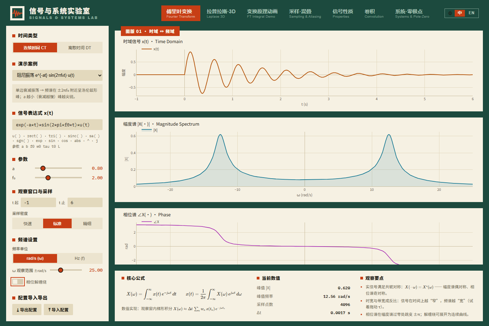
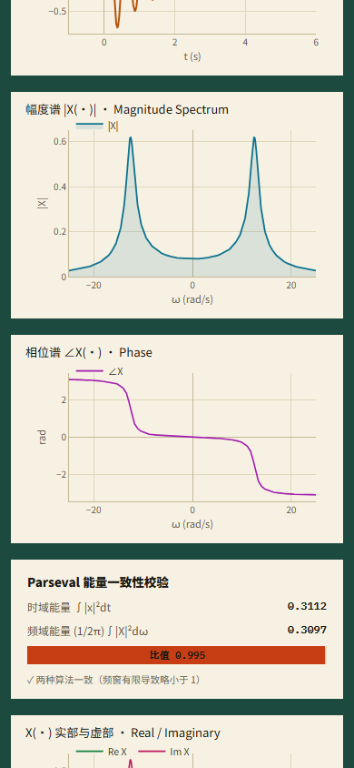

**简体中文** · [English](README.en.md)

# 信号与系统交互实验室

把表达式变成可操作的时域、频域与 s/z 平面实验：改参数、观察变化，再导出图表或分享配置。


[](https://github.com/LINYEANSHU/signals-lab/actions/workflows/ci.yml)
[](LICENSE)

## 实际界面



<details>
<summary>展开手机界面</summary>



</details>

## 快速开始

需要 Node.js 18+；CI 使用 Node 22。

```sh
npm ci
npm run dev
```

打开终端给出的地址，默认 `http://localhost:5173`。依赖安装完成后，应用在浏览器本地运行，无需后端或账号。

先在傅里叶模块选择预设，或输入 `exp(-t*t)`，调整观察窗，比较波形与频谱。顶栏可切换中英文；快捷键 `1`–`7` 切换模块。

## 七种观察方式

| 模块 | 核心操作 |
|---|---|
| 傅里叶变换 | CTFT/DTFT、幅相谱、能量一致性与截断提示 |
| 拉普拉斯 3D | 观察复频域曲面与可移动切面，比较 ROC 和虚轴 |
| 变换原理 | 把乘积、复平面积分与频谱取值联系起来 |
| 采样与混叠 | 改变采样率，观察频谱重复与 sinc 重建 |
| 信号性质 | 对比时移、频移、尺度、微分及卷积定理 |
| 卷积 | 翻转、滑动、相乘和累积，支持 CT/DT |
| 系统与零极点 | 编辑传递函数、放置极点，联动频响和时域响应 |

所有模块提供预设和 JSON 配置快照；图表可导出 PNG。表达式通过 mathjs 的受限语言解析，支持阶跃 `u`、`rect`、`tri`、`sinc`、复数和可调参数。

## 使用体验

- 窄屏图表按可用宽度排布，模块导航可横向滚动。
- 开关可通过键盘聚焦并按 Space 操作；滑块和数字输入具有名称。
- PNG 导出提供等待、失败与重试反馈；无悬停设备也能看到导出入口。
- 图表由 Plotly 绘制，公式由 KaTeX 排版，数学运算与配置留在本地。

## 构建与验证

```sh
npm run build
npm run preview
```

构建会先执行 TypeScript 检查。开发模式自动运行 9 项数学自检，结果见浏览器控制台与 `window.__devtestResults`。本轮检查覆盖七模块的桌面/手机布局、键盘开关、无效表达式恢复和 PNG 下载。

普通图表在浏览器中绘制；3D 曲面需要 WebGL。最近浏览器验证使用 CPU SwiftShader，没有用硬件 GPU，这不表示所有浏览器默认都采用 CPU 后端。

## 数值边界

CTFT 是有限观察窗内的数值近似；信号未衰减会产生截断泄漏。连续时间仿真支持一阶/二阶模型和直接项；离散响应设幅值上限，连续响应只限制时窗，极不稳定参数仍可能数值溢出。图形用于教学与探索，不能替代对任意系统的解析证明。

Plotly 与数值依赖的生产包较大；首次载入时间取决于设备和部署方式。

## 技术与许可

React + TypeScript + Vite，配合 Plotly.js、mathjs 与 KaTeX；这些依赖各自保留原许可。课程组织参考 Oppenheim、Willsky 的《Signals and Systems》中时域、频域和复频域的联系。

项目代码：[MIT](LICENSE)。

## 贡献者

- [LINYEANSHU](https://github.com/LINYEANSHU)
